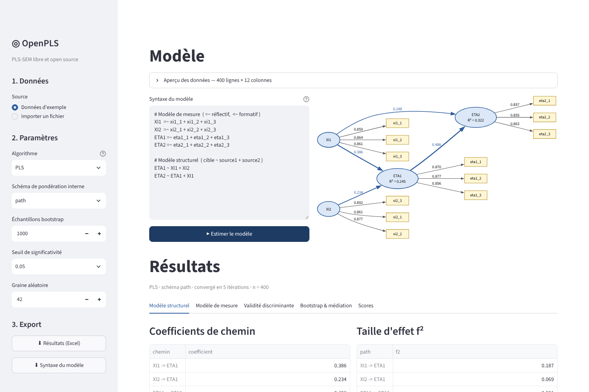

# OpenPLS

Implémentation **libre et open source** du PLS-SEM (*Partial Least Squares Structural Equation Modeling*) en Python : une alternative gratuite aux logiciels commerciaux pour estimer des modèles d'équations structurelles par moindres carrés partiels.

Le code est une **réimplémentation indépendante, écrite à partir de la littérature scientifique publiée**. Il ne contient aucun code, fichier ni ressource d'un logiciel propriétaire.

## Fonctionnalités (v0.2)

| | |
|---|---|
| Algorithme PLS | Wold / Lohmöller, schémas *path*, *factorial*, *centroid* |
| Modèle de mesure | Mode A (réflectif) et mode B (formatif) |
| PLSc | PLS consistant (Dijkstra & Henseler 2015), corrige l'atténuation |
| Fiabilité | Alpha de Cronbach, ρ_A, ρ_c (fiabilité composite), AVE |
| Validité discriminante | HTMT, Fornell-Larcker |
| Modèle structurel | Coefficients de chemin, R², f², effets totaux |
| Médiation | Effets indirects spécifiques (y compris en série), indirects totaux, typologie de Zhao et al. (2010) |
| Inférence | Bootstrap : SE, t, p-values, IC percentiles, sur tous les effets |
| Interface graphique | Import CSV/Excel, diagramme du modèle en direct, tableaux colorés selon les seuils, export Excel |

## Installation

```bash
git clone https://github.com/<ton-compte>/openpls.git
cd openpls
python -m venv .venv && source .venv/bin/activate   # Windows : .venv\Scripts\activate
pip install -e ".[gui]"      # ou ".[dev]" pour lancer aussi les tests
```

## Interface graphique



```bash
openpls-gui
```

Le navigateur s'ouvre sur `http://localhost:8501`. Ensuite :

1. Importe ton fichier CSV ou Excel (une colonne par indicateur), ou essaie les données d'exemple.
2. OpenPLS propose un modèle de mesure en regroupant les colonnes par préfixe (`sat1, sat2…` → `SAT`). Ajoute tes chemins structurels : le diagramme se met à jour en direct.
3. **Estimer le modèle**, puis **Lancer le bootstrap** dans l'onglet *Bootstrap & médiation*.
4. Exporte tous les résultats en Excel depuis la barre latérale.

## Syntaxe du modèle

Inspirée de lavaan, elle fonctionne aussi bien dans l'interface qu'en Python :

```
Image        =~ img1 + img2 + img3        # réflectif (mode A)
Prix         <~ prix1 + prix2             # formatif (mode B)
Satisfaction =~ sat1 + sat2 + sat3
Fidelite     =~ fid1 + fid2 + fid3

Satisfaction ~ Image + Prix               # chemins structurels : cible ~ sources
Fidelite     ~ Satisfaction + Image
```

## Utilisation en Python

```python
import pandas as pd
from openpls import Model, fit, bootstrap, mediation_analysis

data = pd.read_csv("mes_donnees.csv")
model = Model.from_syntax(open("modele.txt").read())

res = fit(data, model)                    # PLS classique
# res = fit(data, model, consistent=True) # PLSc
print(res.summary())
print(bootstrap(data, model, n_boot=5000))

mediation, effets = mediation_analysis(data, model, n_boot=5000)
print(mediation)   # effet indirect, IC, effet direct, type de médiation
```

Démo en ligne de commande : `python examples/demo.py` (ou `python examples/demo.py ton_fichier.csv`).

> **Médiation :** pour pouvoir distinguer une médiation totale d'une médiation partielle, le chemin direct (X → Y) doit figurer dans le modèle. Sinon, OpenPLS indique que le type de médiation est indéterminé.

## Validation

- `pytest` : les tests vérifient que les scores sont un **point fixe exact** des équations PLS, que l'atténuation correspond à la théorie, que **PLSc retrouve les vrais coefficients et effets indirects** d'un modèle simulé, que la médiation totale et la médiation partielle sont bien distinguées, et pilotent l'interface de bout en bout.
- `python tests/crosscheck_plspm.py` : compare avec la bibliothèque indépendante [`plspm`](https://pypi.org/project/plspm/) (nécessite `pandas<3`).

## Feuille de route

- [ ] Lecture des valeurs manquantes (moyenne, suppression)
- [x] Effets indirects / médiation avec bootstrap
- [x] Interface graphique
- [ ] PLSpredict, Q²
- [ ] Analyse multigroupe (MGA), MICOM
- [ ] Modérateurs (termes d'interaction)
- [ ] Éditeur de modèle par glisser-déposer

## Références

- Wold, H. (1982). *Soft modeling: the basic design and some extensions.*
- Lohmöller, J.-B. (1989). *Latent Variable Path Modeling with Partial Least Squares.* Physica.
- Dijkstra, T. K. & Henseler, J. (2015). Consistent partial least squares path modeling. *MIS Quarterly*, 39(2).
- Zhao, X., Lynch, J. G. & Chen, Q. (2010). Reconsidering Baron and Kenny: Myths and truths about mediation analysis. *Journal of Consumer Research*, 37(2).
- Henseler, J., Ringle, C. M. & Sarstedt, M. (2015). A new criterion for assessing discriminant validity. *JAMS*, 43.
- Hair, J. F. et al. (2022). *A Primer on Partial Least Squares Structural Equation Modeling (PLS-SEM)*, 3e éd.

## Licence

MIT — voir [LICENSE](LICENSE).
