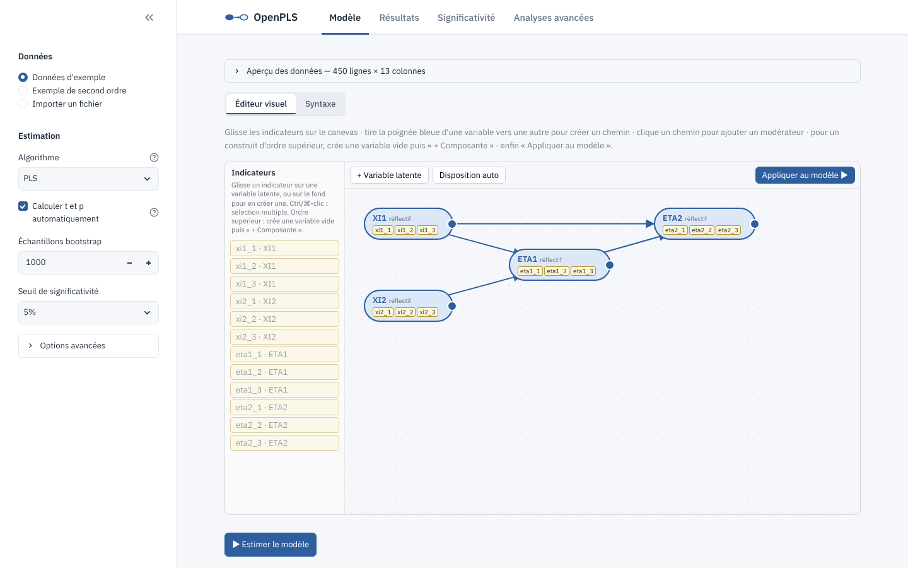
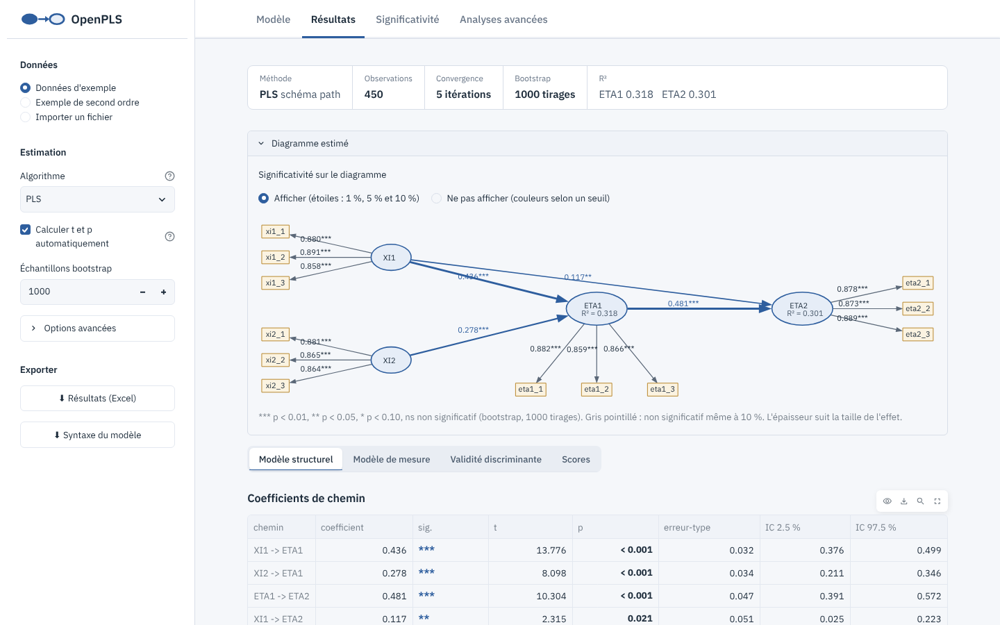
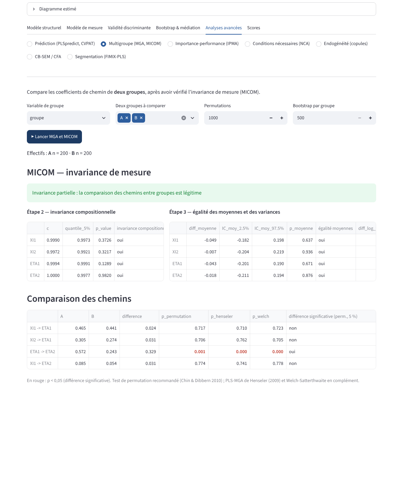

# OpenPLS

Implémentation **libre et open source** du PLS-SEM (*Partial Least Squares Structural Equation Modeling*) en Python : une alternative gratuite aux logiciels commerciaux pour estimer des modèles d'équations structurelles par moindres carrés partiels.

Le code est une **réimplémentation indépendante, écrite à partir de la littérature scientifique publiée**. Il ne contient aucun code, fichier ni ressource d'un logiciel propriétaire.

## Fonctionnalités (v0.8)

| | |
|---|---|
| Algorithme PLS | Wold / Lohmöller, schémas *path*, *factorial*, *centroid* |
| Modèle de mesure | Mode A (réflectif) et mode B (formatif) |
| PLSc | PLS consistant (Dijkstra & Henseler 2015), corrige l'atténuation |
| Fiabilité | Alpha de Cronbach, ρ_A, ρ_c (fiabilité composite), AVE |
| Validité discriminante | HTMT, Fornell-Larcker |
| Modèle structurel | Coefficients de chemin, R², f², effets totaux |
| Médiation | Effets indirects spécifiques (y compris en série), indirects totaux, typologie de Zhao et al. (2010) |
| Inférence | Bootstrap (facultatif) : erreur-type, t, p, IC percentiles ou **BCa**, étoiles (1 %, 5 %, 10 %) ; test de la différence entre deux coefficients |
| Modération | Termes d'interaction `X:M` et effets quadratiques `X:X` : deux étapes, produit des indicateurs, orthogonalisation ; pentes simples ; **indice de médiation modérée** (Hayes 2015) et effets indirects conditionnels |
| Variables de contrôle | `Y ~ X + age` : construit à un indicateur ; colonne texte : indicatrices 0/1 |
| Données | CSV, Excel, **SPSS (.sav)**, **Stata (.dta)** ; valeurs manquantes : suppression par liste, moyenne, imputation par régression |
| Analyses préliminaires | Descriptives, manquants, Mahalanobis, Mardia, corrélations, Harman, colinéarité complète, taille d'échantillon minimale ; figures PNG/SVG |
| Choix de modèle | Comparaison de modèles concurrents (AIC, BIC, HQ, GM, poids) ; **CTA-PLS** (réflectif ou formatif ?) |
| Ordre supérieur | Construits de second ordre réflectifs ou formatifs : deux étapes (disjointe, intégrée), indicateurs répétés ; chargements, poids, VIF, fiabilité du construit |
| Prédiction | PLSpredict (Q²_predict, RMSE, MAE vs régression linéaire), CVPAT |
| Multigroupe | 2 groupes : permutation, PLS-MGA de Henseler, Welch. k groupes : test omnibus par permutation et comparaisons par paires corrigées par Holm. Invariance de mesure MICOM (étapes 1 à 3) |
| IPMA | Carte importance-performance, niveau latente et indicateur |
| NCA | Conditions nécessaires : plafond CE-FDH, taille d'effet d, test de permutation, tableau des goulots |
| Endogénéité | Copules gaussiennes (toutes combinaisons), contrôle de non-normalité |
| CB-SEM / CFA | Maximum de vraisemblance, y compris second ordre ; χ², CFI, TLI, RMSEA (+ IC 90 %), SRMR, AIC, BIC |
| Segmentation | FIMIX-PLS, critères AIC3/AIC4/BIC/CAIC/EN |
| Application | Fenêtre native sous Windows et macOS, sans terminal ni navigateur ; installateurs fournis |
| Interface graphique | Français ou anglais (selon l'installation), éditeur par glisser-déposer, diagramme en direct, aide intégrée par rubriques, recherche de mises à jour |
| Exports | Excel, **rapport Word au format APA**, diagramme PNG/SVG/DOT, **projet .openpls** (données + modèle + réglages), **script Python** reproductible |

[](https://github.com/Geld237/openpls/actions/workflows/tests.yml)

## Installation sans Python (recommandé)

Télécharge le fichier qui correspond à ton ordinateur sur la page [**Releases**](https://github.com/Geld237/openpls/releases/latest) :

| Système | Fichier | Installation |
|---|---|---|
| Windows 10/11 | `OpenPLS-…-Windows-installateur.exe` | double-clic, suis l'assistant ; OpenPLS apparaît dans le menu Démarrer |
| Mac M1, M2, M3… | `OpenPLS-…-macOS-AppleSilicon.zip` | double-clic pour décompresser, puis glisse OpenPLS dans Applications |
| Mac Intel | `OpenPLS-…-macOS-Intel.zip` | idem |
| Linux | `OpenPLS-…-Linux.tar.gz` | décompresse, puis lance `OpenPLS` (s'ouvre dans le navigateur) |

Sous Windows et macOS, OpenPLS est une application normale : elle s'ouvre dans sa propre fenêtre, sans terminal ni navigateur, et se ferme comme n'importe quelle application. Les exports (Excel, CSV, syntaxe) sont enregistrés dans le dossier `Documents/OpenPLS`. **Tout reste sur ton ordinateur** : tes données ne sont envoyées nulle part.

L'application n'est pas encore signée par Microsoft ou Apple, donc au premier lancement :
- **Windows** : si « Windows a protégé votre ordinateur » s'affiche, clique « Informations complémentaires » puis « Exécuter quand même ».
- **macOS** : si macOS refuse d'ouvrir OpenPLS, va dans Réglages Système → Confidentialité et sécurité, puis clique « Ouvrir quand même » en bas de la page.

En cas de problème, les journaux se trouvent dans le dossier `.openpls` de ton dossier personnel.

## Installation avec Python (développeurs)

```bash
git clone https://github.com/Geld237/openpls.git
cd openpls
python -m venv .venv && source .venv/bin/activate   # Windows : .venv\Scripts\activate
pip install -e ".[gui]"      # ou ".[dev]" pour lancer aussi les tests
```

## Interface graphique



```bash
openpls-gui
```

Le navigateur s'ouvre sur `http://localhost:8501`. Ensuite :

1. Importe ton fichier CSV ou Excel (une colonne par indicateur), ou essaie l'un des deux jeux d'exemple : trois groupes A, B et C pour tester la MGA, ou un modèle de second ordre.
2. Construis le modèle dans l'**éditeur visuel** :
   - glisse les indicateurs sur une variable latente, ou sur le fond pour en créer une ;
   - tire la poignée bleue d'une variable vers une autre pour créer un chemin ;
   - clique sur une variable pour la renommer ou la passer en formatif ;
   - clique sur un chemin pour lui ajouter un modérateur ;
   - pour un construit d'ordre supérieur, crée une variable vide, sélectionne-la et ajoute ses composantes avec **+ Composante**.

   Termine par **Appliquer au modèle**. Tu peux aussi écrire directement la syntaxe dans l'onglet *Syntaxe*.
3. **Estimer le modèle** : OpenPLS calcule aussi t et p (bootstrap) et bascule sur l'onglet **Résultats** — diagramme avec étoiles, tableaux des chemins, du modèle de mesure, de validité discriminante et des scores.
4. L'onglet **Significativité** détaille le bootstrap et l'analyse de médiation ; l'onglet **Analyses avancées** regroupe PLSpredict/CVPAT, MGA/MICOM, IPMA, NCA, endogénéité, CB-SEM/CFA et FIMIX-PLS.
5. Exporte tous les résultats en Excel depuis la barre latérale.

Les nombres s'affichent avec une virgule (0,318) ou un point (0.318) selon la langue choisie à l'installation (ou celle du système) ; le réglage se change dans *Options avancées*. Au-dessus du diagramme des résultats, deux choix : **afficher** la significativité, avec des étoiles qui donnent les trois seuils à la fois (*** p < 0,01, ** p < 0,05, * p < 0,10), ou **ne pas l'afficher** et choisir un seul seuil (1 %, 5 % ou 10 %) : les flèches significatives sont alors vertes, les autres rouges. Changer de seuil ne relance pas le bootstrap. Sur le diagramme, les indicateurs de chaque variable latente se placent du côté du bord le plus proche (à gauche pour les variables de gauche, à droite pour celles de droite, en haut ou en bas pour celles du milieu). Si tu as disposé le modèle dans l'éditeur visuel, le diagramme reprend ta disposition. Le bootstrap n'est pas obligatoire : décoche « Calculer t et p automatiquement » pour obtenir les coefficients seuls, plus vite.

La barre du haut (logo et onglets Modèle, Résultats, Significativité, Analyses avancées) reste visible quand tu fais défiler la page. Après l'estimation, un bandeau résume la méthode, la taille de l'échantillon, la convergence, le bootstrap et les R².





## Syntaxe du modèle

Inspirée de lavaan, elle fonctionne aussi bien dans l'interface qu'en Python :

```
Image        =~ img1 + img2 + img3        # réflectif (mode A)
Prix         <~ prix1 + prix2             # formatif (mode B)
Satisfaction =~ sat1 + sat2 + sat3
Fidelite     =~ fid1 + fid2 + fid3

Satisfaction ~ Image + Prix               # chemins structurels : cible ~ sources
Fidelite     ~ Satisfaction + Image + Satisfaction:Image   # modération (X:M)
```

Une interaction `X:M` exige les effets simples `X` et `M` sur la même cible.

Un bloc dont tous les termes sont des variables latentes définit un **construit de second ordre** :

```
Fiabilite  =~ fia1 + fia2 + fia3
Reactivite =~ rea1 + rea2 + rea3
Empathie   =~ emp1 + emp2 + emp3
Qualite    =~ Fiabilite + Reactivite + Empathie   # second ordre réflectif (<~ pour formatif)
Fidelite   ~ Qualite
```

Les composantes (ici Fiabilite, Reactivite, Empathie) ne doivent pas avoir de chemins propres : on relie le construit d'ordre supérieur. L'approche se choisit dans la barre latérale ou avec `fit(..., hoc_method=...)`.

## Utilisation en Python

```python
import pandas as pd
from openpls import Model, fit, bootstrap, mediation_analysis

data = pd.read_csv("mes_donnees.csv")
model = Model.from_syntax(open("modele.txt").read())

res = fit(data, model)                    # PLS classique
# res = fit(data, model, consistent=True) # PLSc
print(res.summary())
print(bootstrap(data, model, n_boot=5000))

mediation, effets = mediation_analysis(data, model, n_boot=5000)
print(mediation)   # effet indirect, IC, effet direct, type de médiation
```

Analyses avancées :

```python
from openpls.moderation import simple_slopes
from openpls.predict import pls_predict, cvpat
from openpls.mga import mga, mga_multi
from openpls.higher_order import higher_order_measurement
from openpls.ipma import ipma
from openpls.nca import nca
from openpls.endogeneity import gaussian_copula
from openpls.cbsem import fit_cbsem
from openpls.fimix import fimix

res = fit(data, model, moderation="two_stage")    # si la syntaxe contient X:M
res = fit(data, model, hoc_method="two_stage_disjoint")  # si elle contient un construit d'ordre supérieur
simple_slopes(res, "Satisfaction", "Image", "Fidelite")
pls_predict(data, model, k=10, repetitions=10)    # {"indicators", "latents"}
cvpat(data, model)
mga(data[model.indicators], model, groups=data["sexe"])        # 2 groupes : comparaison, MICOM, verdict
mga_multi(data[model.indicators], model, groups=data["pays"])  # k groupes : omnibus + paires (Holm)
ipma(res, data, "Fidelite", scale=(1, 7))
nca(res, "Fidelite")
gaussian_copula(res, "Fidelite")
fit_cbsem(data, model)                 # ou cfa=True
fimix(res, segments=range(1, 5))
```

Démo en ligne de commande : `python examples/demo.py` (ou `python examples/demo.py ton_fichier.csv`).

> **Médiation :** pour pouvoir distinguer une médiation totale d'une médiation partielle, le chemin direct (X → Y) doit figurer dans le modèle. Sinon, OpenPLS indique que le type de médiation est indéterminé.

## Validation

`pytest` lance 126 tests, organisés en quatre familles. Ils couvrent environ 95 % du code de calcul ; pour le vérifier : `coverage run --source=openpls -m pytest && coverage report --omit="openpls/app.py,openpls/gui.py"`.

**Cœur PLS**
- OpenPLS concorde, à 10⁻¹⁰ près, avec une **implémentation de référence indépendante** (`tests/reference_pls.py`, écrite lors de l'audit externe), pour les trois schémas de pondération, avec 0, 1 ou 2 blocs formatifs.
- Les scores sont un **point fixe exact** des équations PLS.
- L'atténuation correspond à la théorie.
- **PLSc retrouve les vrais coefficients** et les vrais effets indirects d'un modèle simulé.

**Résultats exacts**
- **Modération :** avec un indicateur unique, l'approche en deux étapes reproduit la régression OLS avec terme produit, à 10⁻¹⁰ près, y compris les pentes simples quand X et M sont corrélés. En PLSc, elle retrouve les vrais coefficients grâce à la correction de Becker et al. (2018).
- **PLSpredict :** dans un modèle à une seule régression, PLS et LM donnent la même erreur.
- **NCA :** un exemple est calculé à la main, et un cas d = 0,5 est connu analytiquement.

**Simulations**
- **MGA :** détecte une vraie différence de chemin.
- **MICOM :** le taux de faux positifs est vérifié autour de 5 %.
- **Copules :** elles corrigent un biais d'endogénéité simulé et déclarent « non interprétable » un régresseur normal.
- **FIMIX :** retrouve deux segments avec une précision égale à celle d'un classifieur qui connaîtrait les vrais paramètres.
- **Ordre supérieur :** en PLSc, l'approche en deux étapes retrouve les vrais coefficients d'un modèle de second ordre simulé. La seconde étape est identique, à 10⁻¹⁰ près, à une estimation faite à la main sur les scores des composantes.
- **MGA à k groupes :** sans vraie différence, le test omnibus rejette dans 2,5 à 5 % des cas, et les paires corrigées par Holm restent sous 5 %.

**Interface**
- Elle est pilotée de bout en bout, pour chaque analyse.

Deux scripts comparent aussi OpenPLS à des logiciels indépendants. Ils demandent `pandas<3` et se lancent dans un environnement séparé.
- `python tests/crosscheck_plspm.py` : comparaison avec [`plspm`](https://pypi.org/project/plspm/). L'écart d'environ 8·10⁻³ vient de plspm, qui s'arrête avant convergence ; la référence indépendante ci-dessus concorde, elle, à la précision machine.
- `python tests/crosscheck_semopy.py` : comparaison du CB-SEM avec [`semopy`](https://pypi.org/project/semopy/), modèles de premier et de second ordre. Le χ² est identique et tous les paramètres libres concordent à 5·10⁻⁴ près.
- `python tests/browser_check.py` : vérifie l'interface dans Chromium (éditeur glisser-déposer, ordre supérieur, changement et remplacement de fichiers), avec `openpls-gui` lancé.

## Confidentialité et limites connues

- `openpls-gui` n'écoute que sur ta machine (`localhost`) : tes données ne sont pas visibles depuis le réseau. Pour partager volontairement l'interface sur un réseau local : `openpls-gui --server.address 0.0.0.0`.
- Les valeurs manquantes sont supprimées par liste (une ligne incomplète est retirée).
- PLSpredict et l'IPMA ne sont pas proposés pour les modèles avec interaction ou d'ordre supérieur.
- MICOM n'est pas corrigé pour les tests multiples : avec beaucoup de construits et de groupes, un rejet isolé peut survenir par hasard.
- Modération avec PLSc : seule l'approche en deux étapes est corrigée (Becker et al. 2018) ; les approches par produit d'indicateurs sous-estiment alors l'interaction.
- Bootstrap : les tirages en échec (fréquents en PLSc avec de petits échantillons) sont exclus, comptés et signalés ; au-delà de 5 % d'échecs, l'interface déclare l'inférence non fiable.
- CB-SEM : un construit à indicateur unique a sa variance d'erreur fixée à 0 (comme `auto.fix.single` dans lavaan).

## Audit

La v0.4 a fait l'objet d'un audit externe indépendant (relecture adversariale du code et des formules, recoupements numériques). Ses 9 constats principaux ont été confirmés, corrigés et couverts par des tests de non-régression (`tests/test_audit.py`) : inférence bootstrap biaisée par l'exclusion silencieuse des tirages en échec, résultats périmés après remplacement d'un fichier, f² recalculé avec d'autres réglages, indicateurs dupliqués acceptés, PLSc ignoré en modération en deux étapes, pentes simples inexactes quand X et M sont corrélés, groupes MGA alignés par position, Fornell-Larcker incohérent en PLSc, construit CB-SEM à indicateur unique non identifié.

## Feuille de route

- [x] Effets indirects / médiation avec bootstrap
- [x] Interface graphique
- [x] Modérateurs (termes d'interaction)
- [x] PLSpredict, CVPAT
- [x] Analyse multigroupe (MGA), MICOM
- [x] IPMA, NCA
- [x] Endogénéité (copules gaussiennes)
- [x] CB-SEM / CFA
- [x] FIMIX-PLS
- [x] Éditeur de modèle par glisser-déposer
- [x] Modèles de second ordre (PLS et CB-SEM)
- [x] MGA à plus de deux groupes
- [ ] PLS-POS (segmentation orientée prédiction)
- [ ] Troisième ordre ; PLSpredict et IPMA pour les modèles d'ordre supérieur ou avec interaction
- [ ] Imputation des valeurs manquantes (aujourd'hui : suppression par liste)
- [ ] Bootstrap parallélisé (aujourd'hui ≈ 13 ms par tirage pour 10 construits et 40 indicateurs)

## Références

- Wold, H. (1982). *Soft modeling: the basic design and some extensions.*
- Lohmöller, J.-B. (1989). *Latent Variable Path Modeling with Partial Least Squares.* Physica.
- Dijkstra, T. K. & Henseler, J. (2015). Consistent partial least squares path modeling. *MIS Quarterly*, 39(2).
- Zhao, X., Lynch, J. G. & Chen, Q. (2010). Reconsidering Baron and Kenny: Myths and truths about mediation analysis. *Journal of Consumer Research*, 37(2).
- Henseler, J., Ringle, C. M. & Sarstedt, M. (2015). A new criterion for assessing discriminant validity. *JAMS*, 43.
- Hair, J. F. et al. (2022). *A Primer on Partial Least Squares Structural Equation Modeling (PLS-SEM)*, 3e éd.
- Becker, J.-M., Ringle, C. M. & Sarstedt, M. (2018). Estimating moderating effects in PLS-SEM and PLSc-SEM. *JAMS*, 46.
- Shmueli, G. et al. (2019). Predictive model assessment in PLS-SEM: guidelines for using PLSpredict. *European Journal of Marketing*, 53(11).
- Liengaard, B. D. et al. (2021). Prediction: coveted, yet forsaken? Introducing a cross-validated predictive ability test in PLS-SEM. *Decision Sciences*, 52(2).
- Henseler, J., Ringle, C. M. & Sarstedt, M. (2016). Testing measurement invariance of composites using partial least squares. *International Marketing Review*, 33(3).
- Chin, W. W. & Dibbern, J. (2010). An introduction to a permutation based procedure for multi-group PLS analysis. In *Handbook of Partial Least Squares*.
- Ringle, C. M. & Sarstedt, M. (2016). Gain more insight from your PLS-SEM results: the importance-performance map analysis. *IMDS*, 116(9).
- Dul, J. (2016). Necessary condition analysis (NCA). *Organizational Research Methods*, 19(1).
- Park, S. & Gupta, S. (2012). Handling endogenous regressors by joint estimation using copulas. *Marketing Science*, 31(4).
- Hult, G. T. M. et al. (2018). Addressing endogeneity in international marketing applications of PLS-SEM. *Journal of International Marketing*, 26(3).
- Hahn, C. et al. (2002). Capturing customer heterogeneity using a finite mixture PLS approach. *Schmalenbach Business Review*, 54.
- Sarstedt, M. et al. (2011). Uncovering and treating unobserved heterogeneity with FIMIX-PLS: which model selection criterion provides an appropriate number of segments? *Schmalenbach Business Review*, 63.
- Becker, J.-M., Klein, K. & Wetzels, M. (2012). Hierarchical latent variable models in PLS-SEM: guidelines for using reflective-formative type models. *Long Range Planning*, 45(5-6).
- Sarstedt, M. et al. (2019). How to specify, estimate, and validate higher-order constructs in PLS-SEM. *Australasian Marketing Journal*, 27(3).
- Holm, S. (1979). A simple sequentially rejective multiple test procedure. *Scandinavian Journal of Statistics*, 6(2).
- Hu, L. & Bentler, P. M. (1999). Cutoff criteria for fit indexes in covariance structure analysis. *Structural Equation Modeling*, 6(1).

## Citer OpenPLS

Le fichier [`CITATION.cff`](CITATION.cff) donne la référence à utiliser ; GitHub l'affiche via le bouton « Cite this repository ».

## Licence

MIT — voir [LICENSE](LICENSE).
